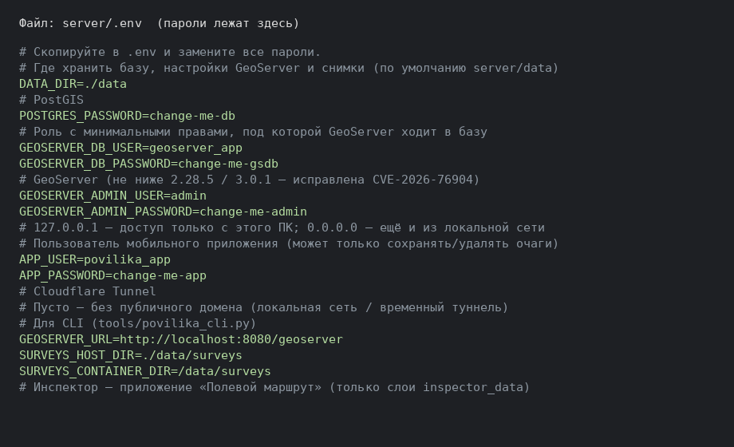
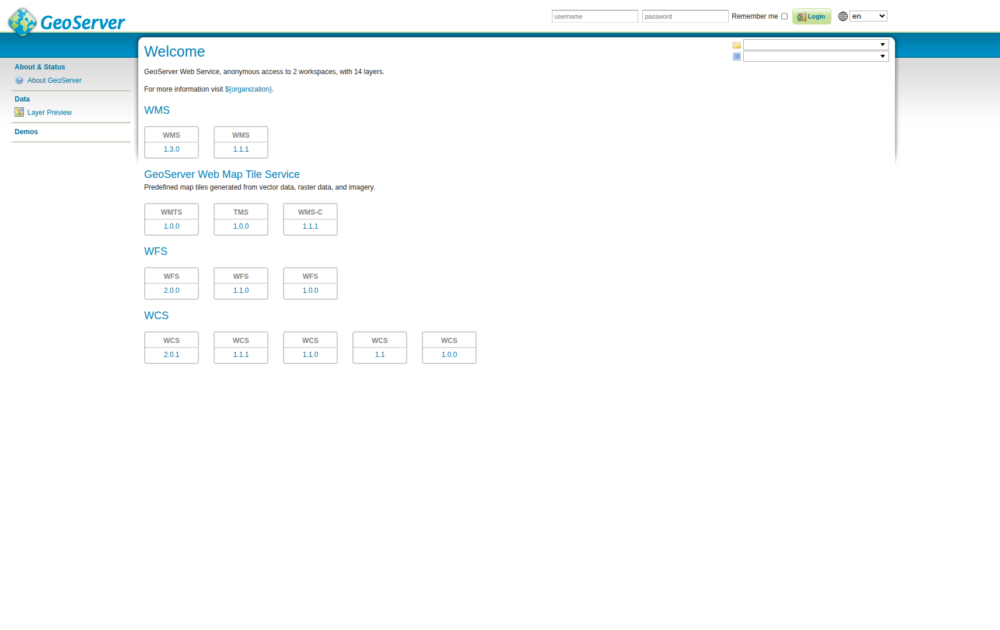
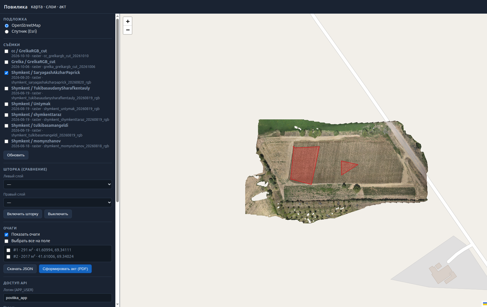
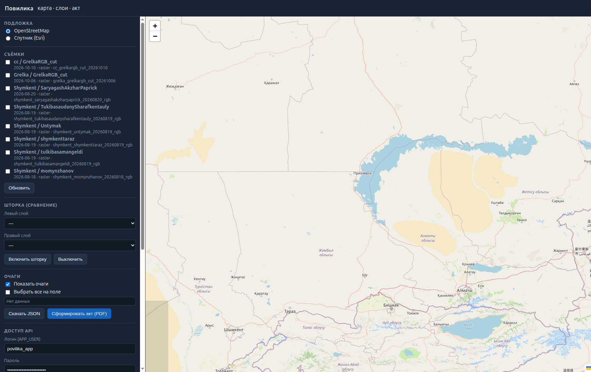

# Руководство: сервер «Повилика»

Кому: кто поднимает сервер, заливает ортофото (TIFF) и смотрит результат в вебе или в приложении.

---

## 1. Что это вообще

На сервере крутится GeoServer + база. В него кладут готовые ортофотопланы (`.tif`). После публикации они видны:

- в браузере — карта на порту **8088**;
- в мобильном приложении «Повилика».

Сырые фото с дрона сюда не шьются. Сюда приходит уже готовый GeoTIFF.

---

## 2. Где лежат пароли и ключи

Всё в файле:

`server/.env`

Его делают из примера:

```bash
cd server
cp .env.example .env
```

Дальше правят пароли руками. Файл **не выкладывают** в общий доступ.



Нужные строки:

| Переменная | Зачем |
|---|---|
| `GEOSERVER_ADMIN_USER` / `GEOSERVER_ADMIN_PASSWORD` | вход в админку GeoServer |
| `APP_USER` / `APP_PASSWORD` | логин приложения и PDF-акта в вебе |
| `DATA_DIR` | каталог данных (снимки, база). Часто это `/data/povilika` |
| `GEOSERVER_URL` | адрес GeoServer для скриптов, обычно `http://localhost:8080/geoserver` |
| `SURVEYS_HOST_DIR` | папка со снимками на диске |

Пароли в этом руководстве не печатаем — смотрите свой `.env`.

---

## 3. Запуск сервера

```bash
cd server
./start.sh
```

Или:

```bash
cd server
docker compose up -d
```

Первый раз (пустая база) — настройка слоёв и пользователя приложения:

```bash
pip install -r ../tools/requirements.txt
python3 ../tools/povilika_cli.py setup
```

Проверка:

- карта: http://127.0.0.1:8088/
- GeoServer: http://127.0.0.1:8080/geoserver/web/  
  логин — `GEOSERVER_ADMIN_USER`, пароль — `GEOSERVER_ADMIN_PASSWORD`



Если с другого ПК в той же сети — в `.env` ставят `GEOSERVER_BIND=0.0.0.0` и перезапускают compose. Иначе снаружи порт не слушается.

---

## 4. Как загрузить TIFF на сервер

Только с машины, у которой есть доступ к диску сервера и к GeoServer (сам сервер или ПК в локальной сети). Тяжёлые файлы через интернет-туннель не гоняют — там лимит около 100 МБ.

Нужен готовый GeoTIFF (`.tif` / `.tiff`).

Команда:

```bash
cd /путь/к/репозиторию
python3 tools/povilika_cli.py ingest /путь/к/ortho.tif \
  --farm "Шымкент" \
  --field "Унтымак" \
  --date 2026-08-19
```

Что пишут в параметрах:

- `--farm` — хозяйство (как будет в списке);
- `--field` — поле;
- `--date` — дата съёмки, формат `ГГГГ-ММ-ДД`.

Перезаписать уже существующий слой:

```bash
python3 tools/povilika_cli.py ingest /путь/к/ortho.tif \
  --farm "Шымкент" --field "Унтымак" --date 2026-08-19 --replace
```

Посмотреть, что уже опубликовано:

```bash
python3 tools/povilika_cli.py list
```

Снять слой с публикации (файл на диске остаётся):

```bash
python3 tools/povilika_cli.py remove имя_слоя
```

Имя слоя берёте из `list`.

Куда файл реально кладётся на диске:

`DATA_DIR/surveys/<хозяйство>/<поле>/<дата>/raster/`

Пример при `DATA_DIR=/data/povilika`:

`/data/povilika/surveys/shymkent/untymak/2026-08-19/raster/`

После удачного `ingest` съёмка появляется в вебе и в приложении. Отдельно в админке GeoServer ничего жать не нужно.

---

## 5. Веб-карта

Адрес на сервере: **http://127.0.0.1:8088/**  
Из сети — `http://<IP-сервера>:8088/` (если открыли bind).



Слева — список опубликованных съёмок. Включаете галочку — на карте ортофото. Очаги повилики — красные контуры (если уже занесены).



Для акта PDF внизу панели вводят логин и пароль из `.env` (`APP_USER` / `APP_PASSWORD`), выбирают очаги и жмут «Сформировать акт (PDF)».

Шторка — сравнение двух включённых растров (левый / правый слой).

---

## 6. Подключение приложения «Повилика»

На телефоне: **Настройки**.

1. Выключить автоопределение адреса (если включено).
2. В поле адреса сервера указать GeoServer, **со путём `/geoserver` в конце**.  
   Примеры:
   - в локальной сети: `http://192.168.1.10:8080/geoserver`
   - через ваш постоянный домен/туннель: `https://maps.ваш-домен/geoserver`
3. Логин — значение `APP_USER` из `.env`.
4. Пароль — значение `APP_PASSWORD` из `.env`.
5. Сохранить.

Дальше в списке съёмок те же поля, что после `ingest`. На карте можно смотреть орто, очаги, сделать акт или полётное задание.

Если список пустой — TIFF ещё не публиковали, или в адресе ошибка (часто забывают `/geoserver` на конце).

---

## 7. Короткий рабочий цикл

1. Получили готовый ортофото `.tif`.
2. На сервере: `povilika_cli.py ingest … --farm … --field … --date …`
3. Проверили `list` или веб http://…:8088/
4. В приложении — тот же адрес GeoServer + `APP_USER` / `APP_PASSWORD`.
5. При необходимости — акт PDF или задание на опрыскивание из приложения / веба.

---

## 8. Если что-то не открывается

| Симптом | Что проверить |
|---|---|
| Не открывается :8088 | `docker compose ps` в папке `server`, контейнеры `gateway` и `geoserver` |
| `ingest` ругается на связь | `GEOSERVER_URL` в `.env`, GeoServer поднялся |
| Нет места на диске | свободное место в `DATA_DIR` |
| В приложении пусто | адрес с `/geoserver`, слой есть в `list` |
| Акт PDF в вебе 401 | логин/пароль именно `APP_*`, не admin |

Админку GeoServer трогают редко. Обычная публикация снимков — через `ingest`, как выше.
